# Enterprise Risk Lab

Sistema web seguro como control de riesgo empresarial. Un frontend en React autentica al usuario con Auth0, obtiene un access token (JWT) y lo envía a un backend Spring Boot protegido como OAuth 2.0 Resource Server. El sistema está desplegado detrás de HTTPS con Apache, Duck DNS y un certificado de Let's Encrypt.

**URL desplegada:** https://luiza-risk.duckdns.org

## Arquitectura

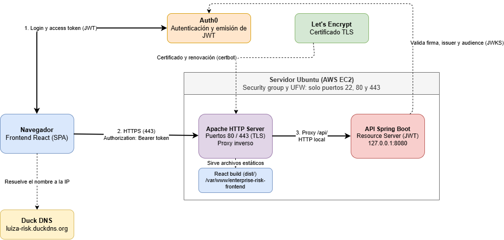

- **Frontend:** React + Vite, con `@auth0/auth0-react` (Single Page Application).
- **Backend:** Spring Boot, Java 21, Spring Security como OAuth 2.0 Resource Server. Expone un único endpoint protegido: `GET /api/risk-status`.
- **Servidor:** Ubuntu en AWS EC2, con Apache como proxy inverso y servidor del frontend.
- **Servicio:** el backend corre como servicio de systemd (`enterprise-risk-api`) con un usuario sin privilegios y escucha solo en `127.0.0.1:8080`.

## Estructura del repositorio

```
EnterpriseRisk/
├── backend/     Spring Boot (API protegida)
├── frontend/    React + Vite + Auth0
├── evidencia/   Capturas, diagrama y salidas de comandos
└── README.md
```

## Ejecución local

**Backend**

```bash
cd backend
./mvnw spring-boot:run
```

Sin token, `http://localhost:8080/api/risk-status` responde `401 Unauthorized`.

**Frontend**

```bash
cd frontend
npm install
npm run dev
```

Crear `frontend/.env.local` (no se versiona) con estas variables:

```
VITE_AUTH0_DOMAIN=<dominio del tenant de Auth0>
VITE_AUTH0_CLIENT_ID=<client id de la SPA>
VITE_AUTH0_AUDIENCE=https://enterprise-risk-api
VITE_API_URL=http://localhost:8080
```

Para producción se usa `frontend/.env.production`, con `VITE_API_URL=https://luiza-risk.duckdns.org`. Tampoco se versiona.

## Evidencias

### Llamada autenticada exitosa (sitio desplegado)

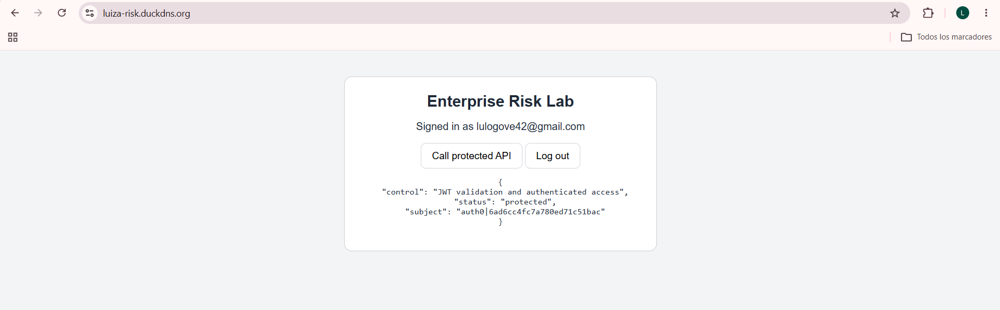

### Inicio de sesión exitoso en el sitio desplegado

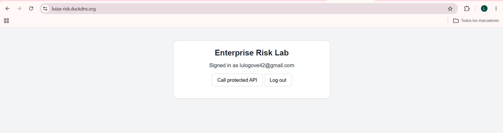

### Certificado válido

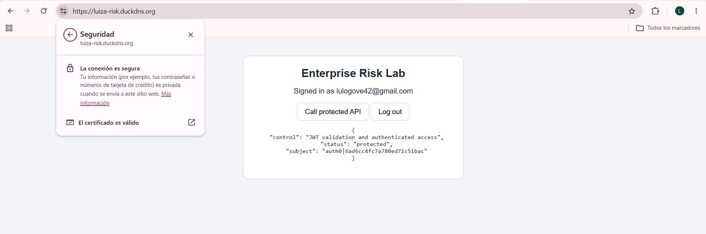

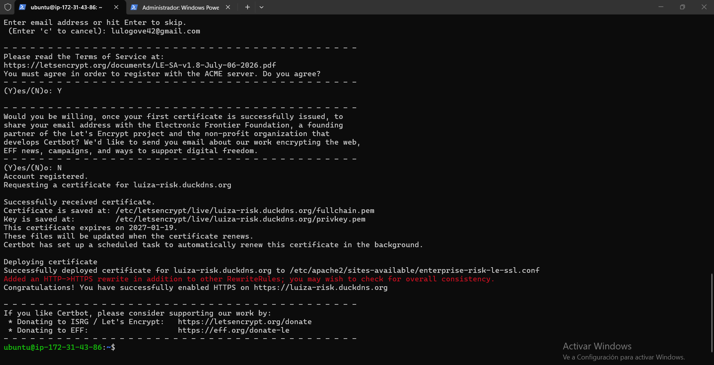

### Solicitud sin token: 401 Unauthorized

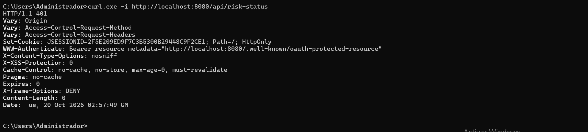

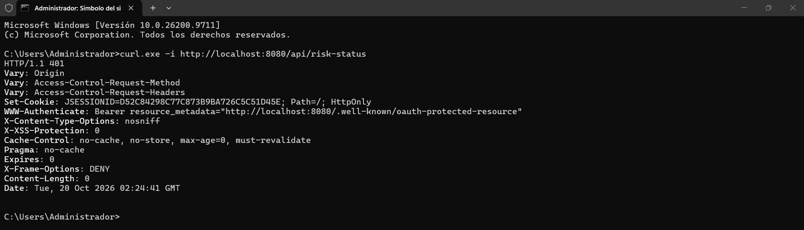

### Redirección HTTP a HTTPS y respuesta de la API

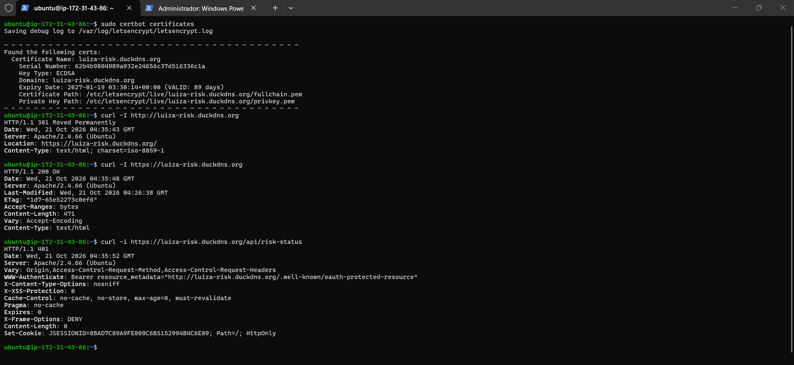

### Puerto 8080 no accesible desde internet

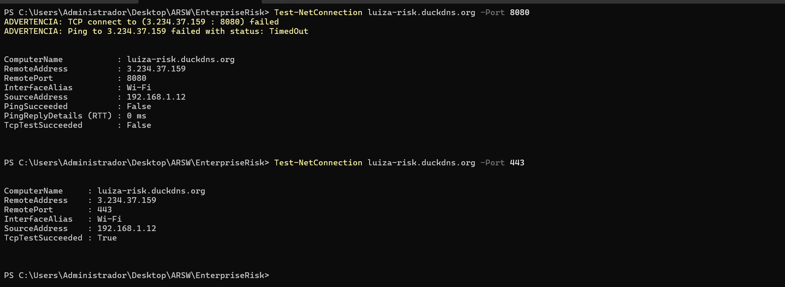

### Resolución DNS del subdominio

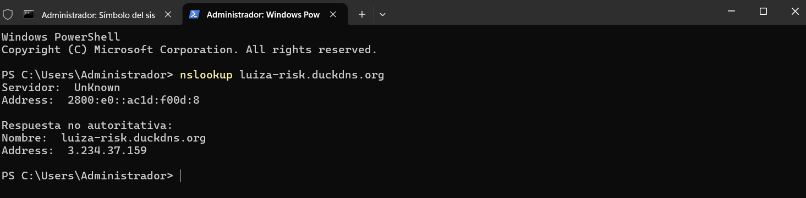

### Versiones de Apache y Certbot

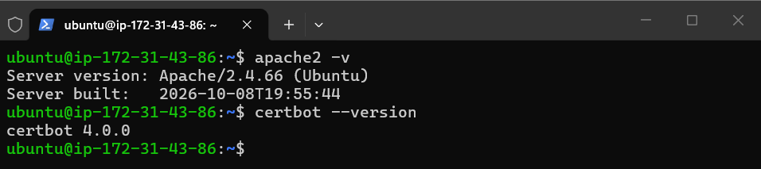

### Logs del servicio

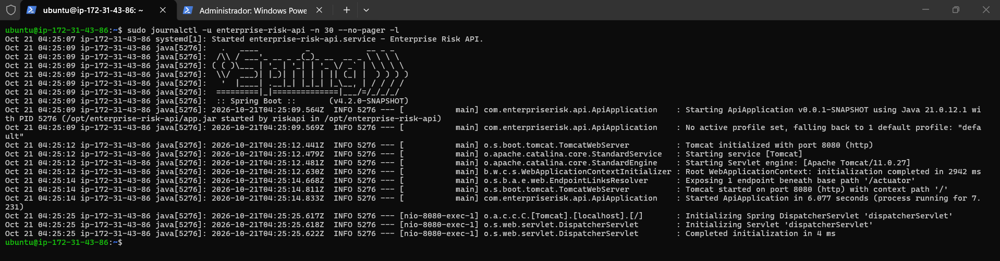

## Lista de verificación

- [x] Las solicitudes sin autenticación a `/api/risk-status` devuelven 401.
- [x] Un usuario con sesión iniciada llama a `/api/risk-status` desde el frontend.
- [x] El backend valida el issuer y el audience del JWT.
- [x] La aplicación está disponible en https://luiza-risk.duckdns.org.
- [x] El navegador muestra un certificado válido.
- [x] El puerto 8080 no es accesible desde internet.
- [x] `sudo certbot renew --dry-run` se ejecuta con éxito.

## Notas de seguridad

- No se versionan `.env.local`, `.env.production`, llaves `.pem`, secretos de Auth0 ni tokens de Duck DNS.
- La SPA usa solo el client ID de Auth0, nunca un client secret.
- CORS está restringido a los orígenes exactos de desarrollo y producción.
- Los access tokens se tratan como datos sensibles: no se muestran ni se registran.
- El firewall (`ufw`) y el security group solo permiten los puertos 22, 80 y 443.